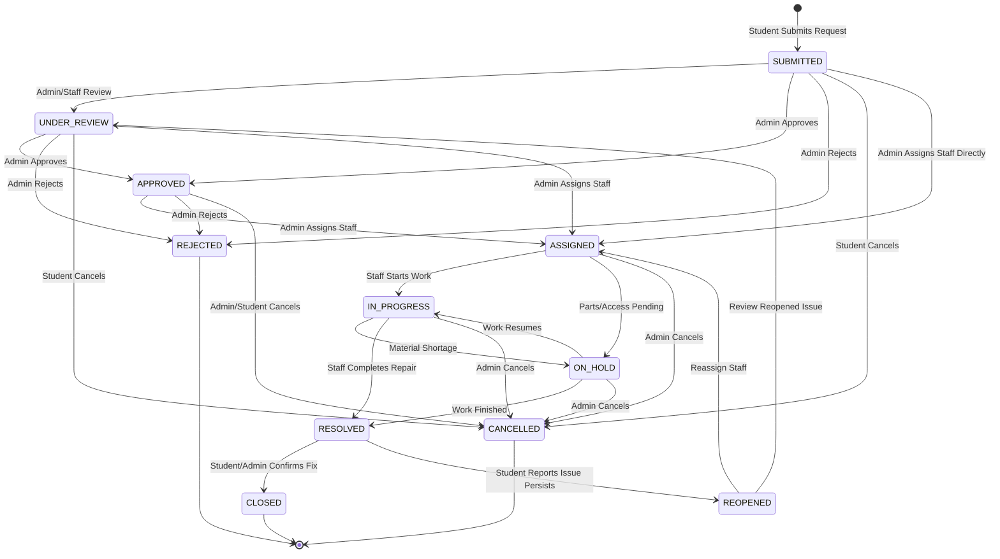

# System Architecture & Design Specification

## 1. Overview & Architectural Principles

CampusCare Backend is constructed using **NestJS 12**, structured following modular architectural boundaries, clean separation of concerns, and multi-tenant domain isolation.

### Core Architectural Axioms
1. **Never Trust the Client:** User identity, tenant (`universityId`), and roles (`role`) are derived solely from validated server-side session cookies. Client-supplied tenant IDs in bodies or headers are rejected or verified strictly against the session context.
2. **Thin Controllers, Rich Services:** Controllers only handle HTTP transport, parameter extraction, and Swagger bindings. All business logic, transaction handling, state transitions, and audit logging reside within injectable services.
3. **Database Access Behind Clear Boundaries:** Data persistence is abstracted via `PrismaService` with transactional safety (`prisma.$transaction`) on all multi-table mutations.
4. **Strict Isolation of Multi-Tenant Data:** Every university-owned record contains a `universityId` foreign key and is verified server-side.

---

## 2. Module Graph & Boundaries

```
src/
├── app.module.ts              # Root configuration, throttler, and global guard bindings
├── config/                    # Type-safe Zod environment validation
├── common/                    # Shared filters, interceptors, decorators, and guards
├── prisma/                    # Database client adapter & lifecycle management
└── modules/
    ├── health/                # Liveness & readiness probes
    ├── auth/                  # Identity, Argon2id, Sessions, Reset & Verification
    ├── users/                 # University user directory & administrative controls
    ├── universities/          # University, Campus, Building & Department hierarchy
    ├── maintenance/           # Request lifecycle, state machine, and assignment logic
    ├── attachments/           # Private storage abstraction & magic-byte validation
    ├── notifications/         # In-app notification engine & preference settings
    └── dashboard/             # Aggregated metrics for student, staff, and admin
```

---

## 3. Maintenance Request State Machine



### Transition Audit Trail
Whenever a transition occurs:
1. `MaintenanceRequest.status` is updated.
2. An entry is recorded in `MaintenanceStatusHistory` capturing `actorId`, `fromStatus`, `toStatus`, `reason`, and timestamp.
3. An in-app `Notification` is automatically delivered to the counterparty (e.g. Student informed of Assignment/Resolution; Staff informed of Assignment).
4. An `AuditLog` entry is logged for compliance.

---

## 4. Multi-Tenancy Implementation

- **Data Schema:** The `University` model represents the root tenant. `Campus`, `Building`, `Department`, `User`, `MaintenanceRequest`, and `AuditLog` all maintain strict foreign key relationships to their respective `universityId`.
- **Server Guard (`TenantGuard`):** Evaluates `request.user.universityId` on all non-public routes. Attempts to supply a foreign `universityId` via parameters or headers produce an immediate `403 Forbidden: Cross-university access is strictly prohibited`.
- **Query Scoping:** Every Prisma read and write operation is bound to `where: { universityId: user.universityId }`.

---

## 5. Security & Session Layer

1. **Authentication:**
   - Password hashing uses native Argon2id (`memoryCost: 19456`, `timeCost: 2`, `parallelism: 1`).
   - Session tokens are generated as 32-byte cryptographic random hex strings.
   - Only the **SHA-256 hash** of the session token is stored in the database.
   - Raw tokens are transmitted in `HttpOnly`, `SameSite=Lax` (or `Strict`), `Secure` cookies.
2. **CSRF Defense:**
   - Double-submit and modern `Sec-Fetch-Site` header checks via `CsrfGuard`.
   - Safe HTTP methods (`GET`, `HEAD`, `OPTIONS`) are exempt.
3. **HTTP Security:**
   - `Helmet` sets strict Content Security Policy, X-Frame-Options (`DENY`), and Strict-Transport-Security (HSTS).
   - Global rate limiter restricts abusive bursts (120 requests/minute).
